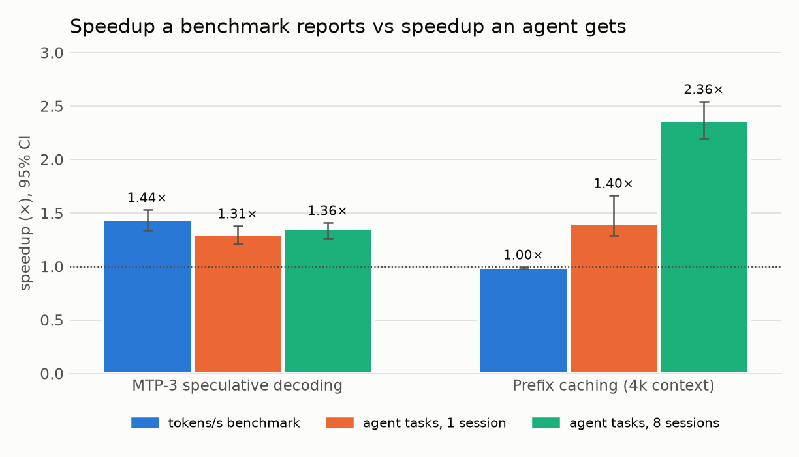

# tpu-agent-latency-bench

**When does faster AI actually help? Benchmarking agent responsiveness on vLLM-TorchTPU.**

*Peter Wei · TorchTPU Sprint 26H4 · topic 2-1 Inference: Zero-to-serving*

Most inference benchmarks report one number: tokens per second. But people using an AI agent don't
wait for tokens. They wait for the **task**: the agent reads its context, calls a tool, waits for the
tool, thinks again, and finally answers. This repository measures how inference speed on a Cloud TPU
translates into **end-to-end agent task time**, and where the two stop agreeing.



📝 Write-up: [blog/blog.md](blog/blog.md) · 📚 Related work: [research/related-work.md](research/related-work.md)

---

## The question

An agent task is a loop, not a single request:

```
user ──▶ LLM ──▶ tool call ──▶ tool runs (waits) ──▶ LLM ──▶ … ──▶ final answer
         └─ prefill + decode ─┘                       └─ prefill + decode ─┘

task time = LLM time + tool time + harness overhead
```

Faster inference only shortens the **LLM** part. If the model is a fraction *f* of task time and
serving makes it *s*× faster, Amdahl's law caps the task speedup at

```
S = 1 / ((1 − f) + f / s)
```

So the useful question is not "how fast is the server?" but:

1. **Where does agent time go?** How much is LLM time (prefill and decode), tool time and overhead?
2. **How elastic is it?** When inference gets *s*× faster, how much faster do tasks get, and when
   does it stop mattering?
3. **Does a tokens/s benchmark predict it?** Can the number usually quoted (decode speed on a plain
   chat benchmark) predict what an agent will feel?
4. **Does speed cost correctness?** Do the optimisations change task success?

Published agent-latency studies are GPU-only. As far as I know, this is the first public
measurement of agent task time on **TPU with vLLM-TorchTPU**. See [related work](research/related-work.md).

## Headline results (Cloud TPU v6e-1, Qwen3.5-4B, vLLM-TorchTPU 0.32.0, 14 Nov 2026)

| Finding | Number |
|---|---|
| Share of task time spent in the model, at 0 / 0.5 / 2 s per tool call | 100% / 66% / 33% |
| MTP-3 speculative decoding: tokens/s benchmark vs agent tasks (0.5 s tools) | 1.44× → **1.31×** |
| Same, with 2 s tools | 1.44× → **1.12×** |
| Prefix caching: tokens/s benchmark vs agent tasks, 4k context, 8 sessions | 1.00× → **2.36×** |
| Prefix caching at 16k context, 8 sessions | **8.1×** |
| Thinking mode: first visible token / task time | 0.06 s → 3.0 s / 5.3× slower, no gain in success |
| Zero to serving: cold / warm server start | 336 s / 250 s |

All speedups come with 95% confidence intervals (see [Method](#method)).

**Takeaways for agent builders**

1. Measure how much of your task time is the model before buying faster inference.
2. Turn on prefix caching first; a tokens/s benchmark will never show its effect on agents.
3. Speculative decoding (MTP) helps when the model dominates; MTP-1 gets most of the gain.
4. Treat thinking mode as a latency budget, and check that it improves success on *your* tasks.

## Method

**Setup.** Qwen3.5-4B served by vLLM-TorchTPU on one Cloud TPU v6e chip, with the `qwen3_coder`
tool-call parser and `qwen3` reasoning parser. Qwen3.5-4B is CI-validated in vllm-torchtpu, ships a
multi-token-prediction (MTP) head, and fits one chip with plenty of KV-cache room.

**Workloads** ([harness/workloads.py](harness/workloads.py)). 15 tasks with checkable answers, each
repeated 3 times per setting:

| Kind | Count | Example |
|---|---|---|
| Single-turn | 6 | "What is 17 × 23? Reply with just the number." |
| Multi-turn | 3 | a three-turn budget calculation |
| Tool-calling | 6 | order lookup, currency conversion, weather, calculator, doc search |

**Tools** ([harness/tools.py](harness/tools.py)) are deterministic mocks that sleep for an injected
latency, the same approach as NVIDIA's agentic trace replay. That isolates one variable: how slow
your tools are. A long-tail (lognormal) option is seeded per task, so every server config sees the
same latencies.

**What is varied** ([scripts/sweep_tpu.sh](scripts/sweep_tpu.sh)):

| Knob | Values | Why |
|---|---|---|
| Speculative decoding (MTP) | off / 1 / 3 draft tokens | lossless, so any change in task time is pure speed |
| Tool latency | 0 / 0.5 / 2 s per call (+ lognormal) | spans the 13–48% tool share reported on GPU |
| Thinking mode | off / on | hidden reasoning delays the first visible token |
| Prefix caching | on / off | agent turns re-send the same prefix |
| Shared context | 4k / 16k tokens | real agent prompts are long and repetitive |
| Concurrency | 1 / 8 sessions | queueing and batching change the picture |

54 cells in about 4.5 hours of TPU time.

**Metrics** ([harness/bench.py](harness/bench.py)):

| Metric | Meaning |
|---|---|
| `task_p50_s`, `task_p95_s` | end-to-end task time, median and tail |
| `ttft_p50_s` | time to the first token of any kind, including hidden reasoning |
| `first_visible_p50_s` | time to the first token a user can see (answer or tool call) |
| `llm_share`, `tool_share`, `overhead_share` | the task-time split; `llm_share` is *f* above |
| `success_rate` | the final answer contains the expected value |
| `output_tok_per_s` | the usual tokens/s number, for comparison |

vLLM's `/metrics` counters are scraped per cell for prefix-cache hit rate and MTP acceptance rate,
so each result has a mechanism, not just a number.

**Statistics** ([analysis/analyze.py](analysis/analyze.py)). Every speedup is a ratio of summed task
times over the same tasks, with a 95% confidence interval from a **paired cluster bootstrap** that
resamples whole tasks (repeats of one task are not independent). The Amdahl check is done **out of
sample**: the token speedup is measured on a separate plain-chat benchmark, then used to predict
agent speedup, which is compared with the measured value.

## Autoserve: an agent that tunes the server for task time

[program.md](program.md) adapts the [autoresearch](https://github.com/karpathy/autoresearch) loop to
serving. A coding agent on the TPU VM edits **only** [serve_config.env](serve_config.env), runs the
fixed benchmark, logs a row, and keeps the change only if median task time improves by more than 2%
without lowering success. The harness and scorer are read-only. Every row also logs TTFT, to answer
a second question: is the TTFT-best configuration the task-best one?

The other loops that run the project (preflight, lab run, study, paper) are described in
[LOOPS.md](LOOPS.md).

## Quick start

**On a laptop, no TPU** (tests, a mock vLLM streaming server, a simulated sweep, figures and a
claim check):

```bash
bash scripts/preflight_local.sh   # first run creates .venv with uv (Python 3.12), ~6 min
```

**On Cloud TPU v6e-1** (from your laptop, then on the VM):

```bash
PROJECT=my-project ZONE=<v6e-zone> bash scripts/tpu_create.sh
```

```bash
git clone https://github.com/Petersonwei/tpu-agent-latency-bench && cd tpu-agent-latency-bench
bash scripts/setup_vm.sh && source ~/venv-vllm/bin/activate
bash scripts/run_experiment.sh   # serve Qwen3.5-4B and run the benchmark once
bash scripts/sweep_tpu.sh        # the full study
```

Delete the VM when you are done: `bash scripts/tpu_create.sh delete`. `tpu_create.sh` refuses to
create a VM unless a billing budget alert exists ([scripts/budget_guard.sh](scripts/budget_guard.sh)).
The step-by-step runbook is [LAB.md](LAB.md).

## Repository layout

```
harness/bench.py          benchmark runner (real endpoint or --sim offline simulator)
harness/workloads.py      fixed tasks with checkable answers
harness/tools.py          deterministic mock tools with injectable latency
serve_config.env          vLLM serve flags (the only file the autoserve agent edits)
program.md                autoserve loop
scripts/                  TPU VM create/setup/sync, smoke test, sweeps, budget guard
analysis/analyze.py       sweep → figures, results table, findings.json
paper/                    paper draft with {{placeholders}} filled from findings.json, claim checker
blog/                     write-up and figures
research/related-work.md  related work with links to the original papers
tests/                    pytest suite and mock vLLM streaming server
LOOPS.md · LAB.md · study.md   loop contracts: how the project is run
```

## Limitations

- One setup: one v6e chip and one 4B model.
- Synthetic tools with fixed latencies (plus one long-tail cell); real tools vary more.
- Only 9 agent tasks, so confidence intervals are wide.
- Success is a substring check: it catches real mistakes but is crude.
- MTP also slowed prompt processing (TTFT) on TPU; not yet explained.

## Credits

Loop design from [karpathy/autoresearch](https://github.com/karpathy/autoresearch) and
[windmaple/autofinetune](https://github.com/windmaple/autofinetune). Built on
[vLLM-TorchTPU](https://github.com/vllm-project/vllm-torchtpu). Thanks to the TPU Builders program.

## License

[MIT](LICENSE)
