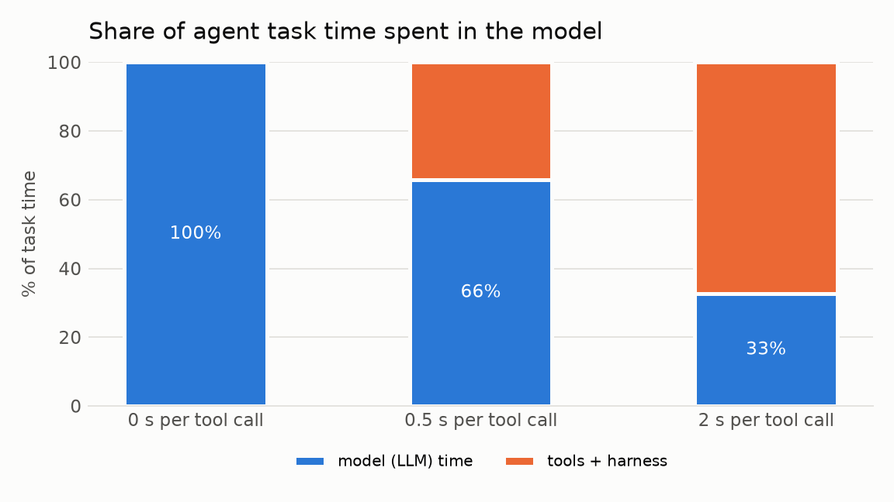
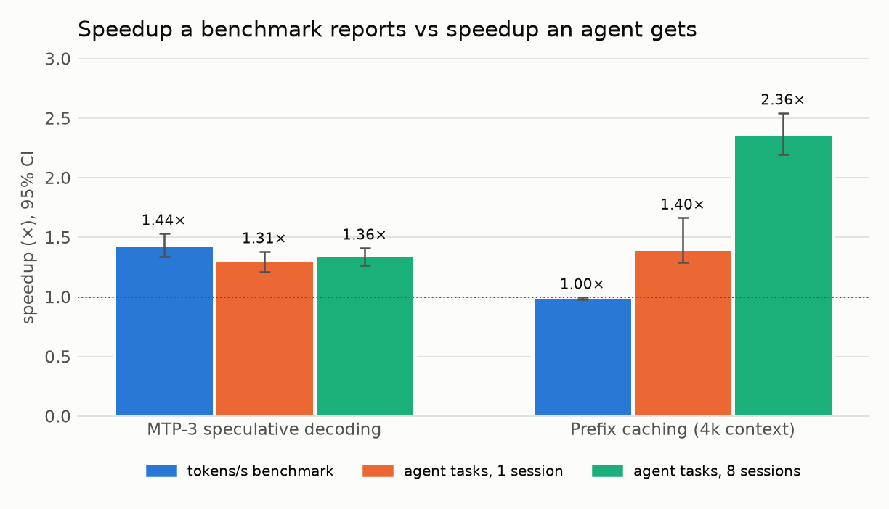
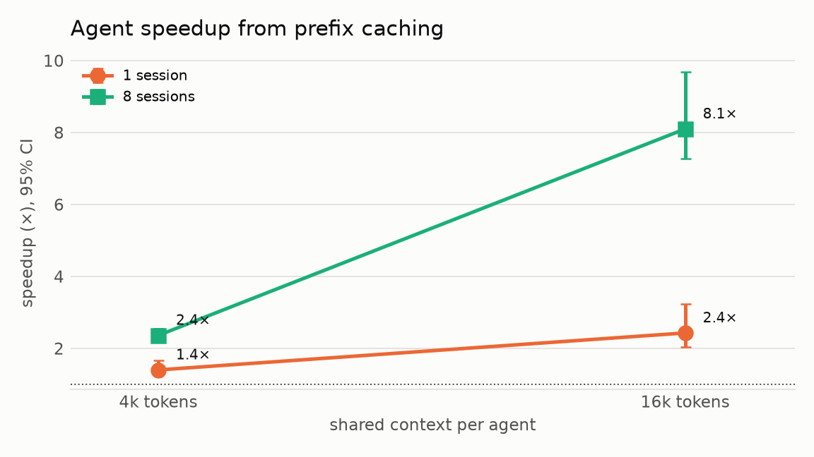

# Tokens per Second Lies to Agent Builders: Benchmarking Agent Responsiveness on Cloud TPU

*Peter Wei · TorchTPU Sprint 2026 · #TorchTPUSprint*

<!-- Every number comes from the TPU run of 14 Nov 2026 (findings.json / results_table.md
     produced by analysis/analyze.py). -->

Most inference benchmarks answer one question: *how many tokens per second?* But nobody using an
AI agent waits for tokens. They wait for the **task**: the agent reads the context, calls a tool,
waits for the tool, thinks again, calls another tool, and finally answers.

So I asked a different question: **when does faster inference actually make an agent faster?**

To find out, I served Qwen3.5-4B with **vLLM-TorchTPU** on a single **Cloud TPU v6e** chip. Then I
timed real agent tasks end to end: single questions, multi-turn conversations, and tool-calling
tasks with checkable answers. The short version:

- A speedup that looks great on a tokens/s benchmark shrinks once tools are involved.
- One feature that does **nothing** on a tokens/s benchmark made my agents up to **8× faster**.

## Zero to serving in about 12 minutes

The TPU VM was ready at 11:19. By 11:31 the model was serving, calling tools correctly, and had
passed my smoke test. The setup script installs vLLM-TorchTPU (0.32.0) with Python 3.12, and needs
no Docker and no custom kernels.

- **Cold start:** the first server start (loading the model and compiling for the TPU) took
  **336 s**.
- **Warm start:** a restart with the compile cache took **250 s**. The cache saved only about a
  quarter of the start time, so most of the wait isn't compilation.
- **Tool calls:** they work out of the box with `--tool-call-parser qwen3_coder`.
- **Thinking mode:** toggled per request.

## How I measured it

The harness ([GitHub](https://github.com/Petersonwei/tpu-agent-latency-bench)) runs 15 tasks with known answers, each repeated 3 times per setting:

- 6 single-turn questions;
- 3 multi-turn conversations;
- 6 tool-calling tasks (order lookup, currency conversion, weather, calculator, doc search).

The tools are mocks that sleep for a fixed time: 0 s, 0.5 s or 2 s per call. NVIDIA's agentic
benchmark replays tool calls the same way. It isolates exactly the variable I care about: how slow
your tools are.

I swept four server configurations:

| Config | What it changes |
|---|---|
| base | prefix caching on (vLLM default) |
| no prefix cache | recompute the whole prompt every turn |
| MTP-1 / MTP-3 | speculative decoding with Qwen3.5's built-in multi-token-prediction head |

I crossed them with three tool latencies, thinking on/off, 1 or 8 concurrent agent sessions, and
4k or 16k tokens of shared context. That's 54 cells in about 4.5 hours of TPU time, which cost
roughly US$12.

Every speedup below has a **95% confidence interval**. It comes from a bootstrap that resamples
whole tasks, because repeats of the same task aren't independent.

## Finding 1: the slower your tools, the less the model matters

With instant tools, 100% of task time is the model. At 0.5 s per tool call it's 66%; at 2 s, only
33%. This is Amdahl's law: if the model is a third of your task time, even an infinitely fast model
can't make the task more than 1.5× faster.

## Finding 2: MTP's speedup shrinks on agents, but predictably

MTP-3 made token generation **1.44× faster** on a plain chat benchmark (95% CI 1.34–1.53).

On agent tasks with 0.5 s tools, the same setting gave **1.31×** (1.21–1.38). With 2 s tools it gave
**1.12×** (1.09–1.15). Here the textbook works: feed the 1.44× token speedup and the model's share
of task time into Amdahl's law, and the prediction lands inside the measured interval for every tool
latency with one session.

Two other observations:

- **MTP-1 vs MTP-3:** MTP-1 (one draft token) gave nearly the same token speedup (1.42×) with a
  higher acceptance rate (91% vs 76%).
- **Concurrency:** acceptance barely changed between 1 and 8 sessions. I expected a drop, based on
  recent papers on speculative decoding under load.

## Finding 3: the feature tokens/s can't see

Turn prefix caching off and the tokens/s benchmark doesn't move: **1.00×**. If that's all you
measured, you'd conclude it doesn't matter.

For agents, it matters a lot. Every turn of an agent re-sends the same system prompt, tool
definitions, context and conversation history. With prefix caching, vLLM reuses that work instead
of recomputing it. With 4k tokens of shared context, it made agent tasks:

- **1.40× faster with one session** (95% CI 1.29–1.67);
- **2.36× faster with eight** (2.20–2.55).

The effect grows with context. At 16k tokens it was **2.4×** with one session and **8.1×** with
eight (7.3–9.7). At 16k context, the median time to first token was 0.07 s with caching and 0.83 s
without.

One more TPU-specific result. Qwen3.5 is a *hybrid* model: most of its layers use linear attention,
which makes prefix caching harder, and vLLM's support for it is still marked experimental. I
logged vLLM's own counters to check it was really working. The cache hit **95–98%** of the time
with one session. With eight sessions at 4k context it fell to 80%, and recent papers report the
same kind of drop under load.

## Finding 4: thinking mode costs more than it buys (here)

With thinking on, the first *visible* word arrived after **3.0 s** on average instead of 0.06 s.
Tasks took **5.3× longer** (95% CI 2.7–10.7), and success didn't improve: 80% with thinking vs 87%
without.

For short tool-calling tasks on a 4B model, thinking was pure latency. That may change for harder
tasks or larger models, and I'd test it before turning it on.

## What I'd tell an agent builder

1. **Measure how much of your task time is the model before buying faster inference.** If the model
   is 33% of the task, a 1.44× faster model is a 1.1× faster agent.
2. **Turn on prefix caching first.** The win grows with context length and with concurrent users,
   and a tokens/s benchmark will never show it to you.
3. **Use speculative decoding (MTP) when the model dominates.** It's free speed when tools are
   fast; MTP-1 already gets most of the gain.
4. **Treat thinking mode as a latency budget, not a free upgrade.** Check that it improves success
   on *your* tasks.
5. **Benchmark the task, not the token.** That's the harness I'm releasing.

## Limitations

- **One setup:** one v6e chip and one 4B model.
- **Mock tools:** synthetic tools with fixed latencies, plus one long-tail cell. Real tools vary
  more.
- **Small task set:** only 9 agent tasks, so the confidence intervals are wide.
- **Crude grading:** success is a substring check. It caught real model mistakes, such as "Sydney"
  for Australia's capital, but it is crude.
- **One open puzzle:** MTP also slowed down prompt processing (time to first token) on TPU. That's
  why a finer "prefill + decode" prediction did worse than the simple one. I'll dig into this next.

## Reproduce it

Everything is open: the harness, the sweep script, and the analysis code that produced every
number here: **[github.com/Petersonwei/tpu-agent-latency-bench](https://github.com/Petersonwei/tpu-agent-latency-bench)**.

One command sets up a TPU v6e VM. One more runs the full sweep. A local preflight (tests, a mock
vLLM server and a simulated sweep) checks everything before you spend anything on TPU time.

*Built for the TorchTPU Sprint. Thanks to the vLLM-TorchTPU team. #TorchTPUSprint*
